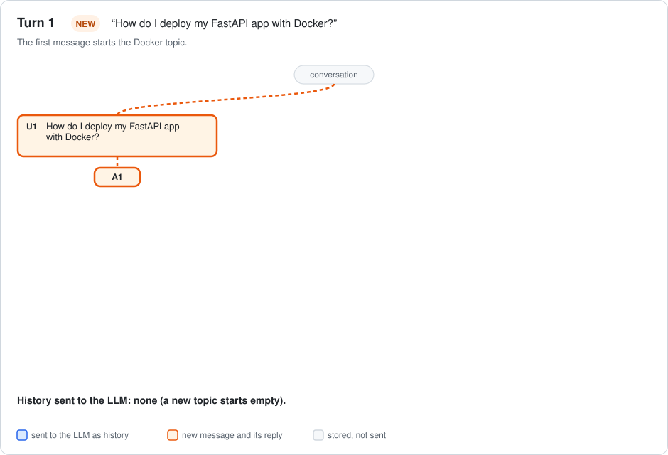
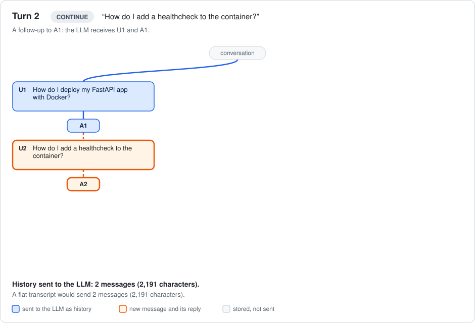
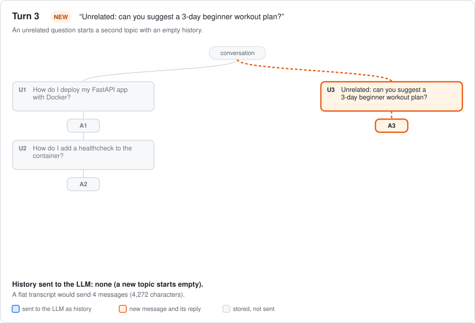
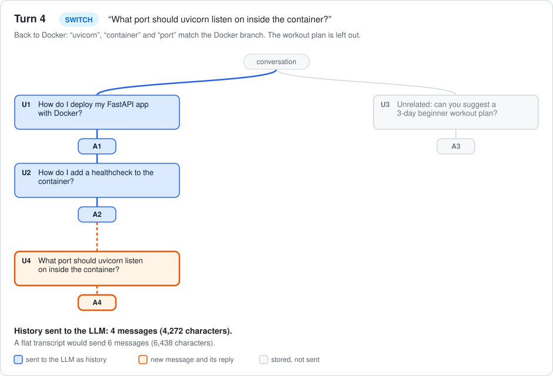
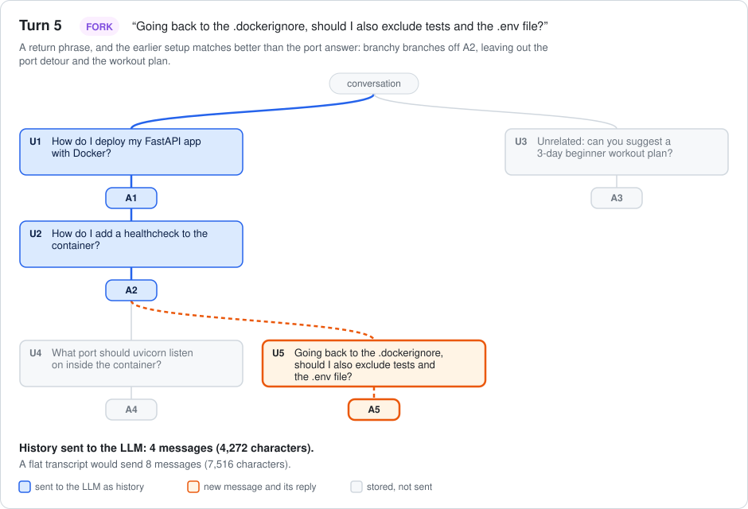

# branchy-chat

[](https://pypi.org/project/branchy-chat/)
[](https://pypi.org/project/branchy-chat/)
[](https://github.com/saibhaskerraju/branchy/blob/master/LICENSE)

Conversation memory as a tree for LLM chat. Before each reply, branchy decides
where the new message belongs (the current branch, an earlier answer, or a new
topic) and sends the LLM only that branch's history.

- **Tree-shaped history.** A message can continue the current branch, return to
  another topic, branch off an earlier answer, or start a new topic.
- **Rules first, LLM only when unsure.** A rule-based router places every
  message without calling a model (10–25 ms per message in our tests, for
  conversations of up to 120 messages) and gives the same result on any
  machine. Only placements it marks uncertain are checked by your LLM.
- **Every placement explained.** The scores, the checks and the exact history
  sent to the LLM are stored with each message.
- **Any LLM supported by [LiteLLM](https://docs.litellm.ai/)** (OpenAI,
  Anthropic, Ollama, vLLM, a LiteLLM proxy, and more).
- **Live HTML viewer** of every conversation, and **SQLite storage** that is
  safe to share between processes.

## Installation

```bash
pip install branchy-chat
```

The package is installed as `branchy-chat` and imported as `branchy`. It needs
Python 3.12 or later. Dependencies: `pydantic`, `litellm`, `tokenizers`. The
router's embedding model and data are bundled (about 9 MB), so routing needs
no downloads and no network access.

## Quick start

```python
from branchy import BranchingChat

with BranchingChat(model="gpt-4o-mini", api_key="<your key>") as chat:
    chat.add_message("How do I build an index in Postgres?")
    print(chat.last_reply)    # the LLM's answer
    print(chat.describe())    # ★ new topic

    chat.add_message("What if I need it to not lock the table?")
    print(chat.describe())    # ↳ continue under A1
```

`chat.show_tree()` prints the whole tree as text, and `chat.explain()` shows why
the last message was placed where it was.

`model` is required: it writes the replies and checks uncertain placements. Pass
any model string LiteLLM accepts, with a provider prefix where needed
(`model="anthropic/claude-haiku-5-5"`). For a LiteLLM proxy, Ollama or vLLM,
also set `api_base`.

## Example: five messages, one tree

One conversation that mixes two topics, in the order a person might really
write it. In each picture, **blue** is the history the LLM received for the new
message, **orange** is the new message and its reply, and **grey** is stored but
not sent. `U<n>` is the n-th user message and `A<n>` its reply.











| Turn | Message | Placement | History sent by branchy | A flat transcript sends |
|---|---|---|---|---|
| 1 | How do I deploy my FastAPI app with Docker? | new topic | none | none |
| 2 | How do I add a healthcheck to the container? | continue under A1 | 2 messages | 2 messages |
| 3 | Unrelated: can you suggest a 3-day beginner workout plan? | new topic | none | 4 messages |
| 4 | What port should uvicorn listen on inside the container? | switch to A2 | 4 messages | 6 messages |
| 5 | Going back to the .dockerignore, should I also exclude tests and the .env file? | fork under A2 | 4 messages (4,272 characters) | 8 messages (7,516 characters) |

What this shows:

- **Topics stay separate.** The workout question gets no Docker history, and
  the Docker questions never see the workout plan.
- **You can come back to a topic.** Turn 4 picks the Docker branch up where it
  left off, recognised by the words "uvicorn", "container" and "port".
- **Detours are dropped.** Turn 5 goes back to the setup and leaves out the port
  discussion, so the LLM receives 43% fewer characters than with a flat
  transcript.


## Concepts

| Term | Meaning |
|---|---|
| **Topic** | A first message and everything below it: one top-level entry in the tree. Routing output calls it a *thread* (`thread_id`, `threads`). |
| **Branch** | The path from a topic's first message down to one reply. A branch is exactly the history the LLM receives. |
| **Fork** | Two follow-ups under the same answer. Each follow-up starts its own branch. |
| **FIRM / TENTATIVE** | How sure the router is about a placement. TENTATIVE placements are checked by the LLM. |

## How routing works

Each user message gets exactly one reply, so the tree can only split at a reply.
For a new message the router chooses one parent: a reply, or none.

| Action | Parent | Effect |
|---|---|---|
| `CONTINUE` | the latest reply in the current branch | the branch grows |
| `SWITCH` | the latest reply of another topic or branch | that branch resumes |
| `FORK` | an earlier reply that already has a follow-up | a new branch beside that follow-up |
| `NEW` | none | a new topic |


### Accuracy

Measured with `eval/run.py` on labelled conversations. *Correct* means the
router chose the labelled parent; *history lost* means the parent the message
needed was not in the history sent to the LLM.

| Test set | Messages | Correct (rules) | History lost | TENTATIVE |
|---|---|---|---|---|
| Project set (written during development) | 67 | 94.0% (98.5% with the LLM check) | 2.9% | 31% |
| Short answers to an assistant question | 21 | 95.2% (100% with the LLM check) | 8.3% | 14% |
| [TopiOCQA](https://huggingface.co/datasets/McGill-NLP/TopiOCQA), one topic per conversation | 2,514 | 95.8% | 4.5% | 37% |
| TopiOCQA, two conversations interleaved | 2,165 | 80.8% | 20.0% | 35% |

The first two sets are small and written by the developers. TopiOCQA is
independent (crowd-written questions), but its topic returns are artificial:
two conversations spliced together. See [`eval/README.md`](eval/README.md).

### Placing a message yourself

```python
chat.add_message("And which port?", reply_to=chat.message_id("A1"))  # under reply A1
chat.add_message("A completely new question", new_topic=True)       # a new topic
```

Both skip routing and are recorded as `decided_by="explicit"`.

### Inspecting a placement

```python
print(chat.explain())    # the last placement: cues, every check, every score
decision = chat.last_decision
decision.action          # "NEW" | "CONTINUE" | "SWITCH" | "FORK"
decision.confidence      # "FIRM" | "TENTATIVE"

path = chat.tree.get_path_to_root(chat.last_message_id)   # the branch, top to bottom
history = [{"role": n.node_type, "content": n.content} for n in path]
```

The full algorithm and its thresholds are specified in
[ADR 0002](decisions/0002-routing-algorithm.md).

## Tree viewer

An HTML view of every conversation, with no extra dependencies. Each message is
a box in a collapsible tree, with badges for the routing action, `tentative`,
`active` (the latest reply) and fork points. Selecting a message shows its prompt
and reply, the routing decision with all scores, the path to the top, and the
exact history the LLM received. The page refreshes automatically when the tree
changes.

The viewer is a development and debugging tool. **It has no authentication.**

### Inside a web app (recommended)

```python
from fastapi import FastAPI
from branchy import BranchingChat

chat = BranchingChat(model="gpt-4o-mini", api_key="<your key>")
app = FastAPI()
app.mount("/branchy", chat.viewer_app())   # open http://<your app>/branchy/
```

For WSGI frameworks (Flask, Django) use `chat.viewer_app(kind="wsgi")`. The
viewer then shares your app's port, middleware and authentication; mount it
behind whatever protects the rest of your app.

### Standalone (scripts, notebooks, console apps)

```python
chat = BranchingChat(model="gpt-4o-mini", api_key="<your key>", viewer=True)
print(chat.viewer_url)   # http://127.0.0.1:8787
chat.close()             # stops the viewer and closes the store
```

| Option | Default | Notes |
|---|---|---|
| `viewer_port` | `8787` | `0` lets the OS choose. A busy port falls back to a free one, with a warning. |
| `viewer_host` | `127.0.0.1` | Inside a container, use `0.0.0.0` and publish the port, or mount the viewer in your app. |
| `viewer_refresh_seconds` | `2` | How often the page checks for changes. |
| `viewer_policy` | `"auto"` | `"auto"` does not start the standalone viewer inside a web-server process; `"allow"` always starts it; `"deny"` never does. |

Setting the environment variable `BRANCHY_VIEWER_DISABLE=1` turns the viewer
off everywhere.

### Static export and external viewing

```python
chat.export_viewer_html("tree.html")   # one self-contained HTML file
```

To view a database from outside the app (for example, a Docker volume):

```bash
python -m branchy.viewer --db /path/to/branchy.sqlite3 --port 8787
```

## Storage

By default every message is saved to `.branchy/branchy.sqlite3` (SQLite in WAL
mode), and reopening a `BranchingChat` reloads the tree.

```python
chat = BranchingChat(model="...", store="path/to/chat.sqlite3", tree_id="support")
chat = BranchingChat(model="...", store=None)   # in memory only
```

Several processes can share one database file:

- Before routing, `add_message` reloads the tree if another process has written
  to it.
- Each message is saved in one transaction that checks the expected version.
- If another process wrote first, branchy reloads, re-routes and retries once;
  a second conflict raises `StoreConflict`.

The router keeps no state of its own; it rebuilds everything from the stored
messages.

## Limitations

- **English only.** Cue phrases ("going back to", "unrelated", …) are English.
- **Limited world knowledge in the rules.** The built-in embedding model knows
  word similarity, not facts: it cannot tell that "a soft one" after a joke
  means a boiled egg. Such cases are usually TENTATIVE and go to the LLM.
- **Returning to an earlier topic after a detour is unreliable.** On TopiOCQA's
  interleaved conversations, 48% of returns were placed correctly. A return that
  names the topic ("What port should uvicorn use?") works; one that only points
  ("what about the latter?") stays in the current topic.
- **Short follow-ups with no pointer can start a new topic.** "who was the
  director?" or "how much?" share no words with the conversation and contain no
  "it" or "that", so the router may start a new topic, often as FIRM (no LLM
  check). This was 70 of 2,514 TopiOCQA messages.
- **One common shared word can pull a short message to another topic.** "where
  was she born?" can move to another topic whose answers mention "born".
- **Automatic forks are often wrong.** On TopiOCQA, 36–41% of forks were
  acceptable: phrases like "mentioned previously" trigger a fork to the wrong
  earlier answer. Use `reply_to=` to fork explicitly.
- **Extra latency on uncertain messages.** Each TENTATIVE placement adds one
  short model call before the reply (about 1 s in our tests).
- **Data sent to your model provider.** The routing check sends short excerpts
  of the conversation (up to 300 characters per reply) to the same provider as
  the replies.
- **One reply per message.** Regenerating a reply as a second version is not
  supported.

## API reference

- `BranchingChat(*, model, api_key=None, api_base=None, router_config=None, system_prompt=None, store="default", tree_id="default", viewer=False, viewer_policy="auto", viewer_host="127.0.0.1", viewer_port=8787, viewer_refresh_seconds=2)`: usable as a context manager.
  - `model` is required: any [litellm](https://docs.litellm.ai/docs/providers) model string. It writes the replies and reviews TENTATIVE placements.
  - `store`: `"default"` (`.branchy/branchy.sqlite3`), a file path, any `TreeStore`, or `None` (memory only).
  - `add_message(user_message, assistant_message=None, *, reply_to=None, new_topic=False) -> str`: places the message, writes the reply (or stores the one you pass), saves both, and returns the user message id.
  - `last_decision`, `last_message_id`, `last_reply`: results of the last `add_message`.
  - `show_tree()`, `show_subtree(message_id)`: the tree as text, with `U<n>`/`A<n>` labels.
  - `describe(decision=None)`: one line, such as `⑂ fork under A1 (sister of U2)`. `explain(decision=None)`: the full decision.
  - `message_id("A3")`: the id behind a label.
  - `viewer_app(kind="asgi")`, `start_viewer()`, `stop_viewer()`, `viewer_url`, `export_viewer_html(path)`, `close()`.
  - `tree`: the `ConversationTree`.
- `ConversationTree`: `messages` (a dict of id → `MessageNode`), `get_path_to_root(message_id)` (root first), `get_root_messages()`, `to_dict()`, `from_dict(data)`, `snapshot()`.
- `MessageNode` (`from branchy.models import MessageNode`): `message_id`, `content`, `node_type` (`"user"` or `"assistant"`), `parent_message_id`, `child_message_ids`, `created_seq`, `created_at`, `tentative`, `routing` (the placement, as a dict, on user messages).
- `RoutingDecision`: `action`, `target_message_id`, `confidence`, `decided_by` (`"rules"`, `"explicit"` or `"llm"`), `uncertainty` (`"band"`, `"reference"` or `"margin"` when TENTATIVE), `llm`, `reason`, `cues`, `gates`, `threads`, `candidates`.
- `ThreadRouter(config=RouterConfig())`: `.route(tree, message, *, reply_to=None, new_topic=False) -> RoutingDecision`. Rules only; never calls an LLM.
- `RouterConfig`: every routing threshold (see [ADR 0002](decisions/0002-routing-algorithm.md)).
- `SQLiteStore(path=".branchy/branchy.sqlite3")`, the `TreeStore` protocol, `StoreConflict`.
- Viewer, over any snapshot provider (a callable returning a tree snapshot):
  - `asgi_app(snapshot_provider, refresh_seconds=2, version_provider=None)`, `wsgi_app(...)` with the same arguments.
  - `TreeViewer(snapshot_provider, host="127.0.0.1", port=8787, refresh_seconds=2, version_provider=None)`.
  - `render_static_html(snapshot)`: one self-contained HTML file.
  - `version_provider` is optional: a callable returning the tree's version number. With it, a poll of an unchanged tree returns early without loading the snapshot.
- `branchy.router` also exports `RoutingJudge` (the LLM review of TENTATIVE placements, [ADR 0004](decisions/0004-llm-review-of-tentative-decisions.md)) and `LLMReview` (its result, stored in `RoutingDecision.llm`).

## Design decisions

The reasoning behind the design is recorded as architecture decision records
(ADRs):

| ADR | Topic |
|---|---|
| [0001](decisions/0001-message-tree-and-placement.md) | The message tree, and what the router decides |
| [0002](decisions/0002-routing-algorithm.md) | The routing algorithm, its thresholds and the evidence for them |
| [0003](decisions/0003-static-embeddings-and-background-corpus.md) | The built-in embedding model and its background data |
| [0004](decisions/0004-llm-review-of-tentative-decisions.md) | LLM review of TENTATIVE placements |

## Development

```bash
git clone https://github.com/saibhaskerraju/branchy.git
cd branchy
uv sync                              # installs the package and pytest
uv run pytest                        # tests (offline: the LLM is replaced by a fake)
python eval/run.py --verbose         # routing accuracy on labelled conversations
python eval/run.py --llm             # the same, with the LLM check (needs LLM_MODEL, LLM_API_KEY)
python tools/build_topiocqa_eval.py  # download and convert the TopiOCQA test sets (not run by default)
python eval/run.py eval/scenarios-topiocqa/chains.json
python tools/build_router_data.py    # rebuild the bundled router data (downloads sources)
```

TopiOCQA is licensed CC BY-NC-SA 4.0, so the converted files are git-ignored and
never shipped. Ideas that are recorded but not scheduled (a trained cue
classifier, typo tolerance, untested scenarios) are in [`docs/ideas/`](docs/ideas/).

[`examples/terminal.py`](https://github.com/saibhaskerraju/branchy/blob/master/examples/terminal.py)
is an interactive chat for trying branchy. It reads `LLM_MODEL`, `LLM_API_KEY`
and `LLM_API_BASE` from the environment, prints each branch as JSON, and starts
the viewer. Commands: `/tree`, `/why`, `/quit`.

The repository includes a dev container. If you use Claude Code, it also
installs `arxiv-mcp-server`, which `.mcp.json` registers as an MCP server.

See [`eval/README.md`](https://github.com/saibhaskerraju/branchy/blob/master/eval/README.md)
for the evaluation method and metrics, and
[`CHANGELOG.md`](https://github.com/saibhaskerraju/branchy/blob/master/CHANGELOG.md)
for changes between versions.

## License

Licensed under the [Apache License 2.0](https://github.com/saibhaskerraju/branchy/blob/master/LICENSE).
Copyright 2026 Bhasker Raju.

If you redistribute branchy-chat or a work based on it, the license requires you
to keep the copyright notice and to include the attribution notices from the
[`NOTICE`](https://github.com/saibhaskerraju/branchy/blob/master/NOTICE) file.

### Credits

- Embeddings: [potion-base-8M](https://huggingface.co/minishlab/potion-base-8M)
  by MinishLab (MIT License), quantised to int8.
- Background statistics derived from
  [WildChat-1M](https://huggingface.co/datasets/allenai/WildChat-1M) (Allen
  Institute for AI, ODC-BY) and
  [OpenAssistant oasst2](https://huggingface.co/datasets/OpenAssistant/oasst2)
  (Apache License 2.0). No prompt text is included.
